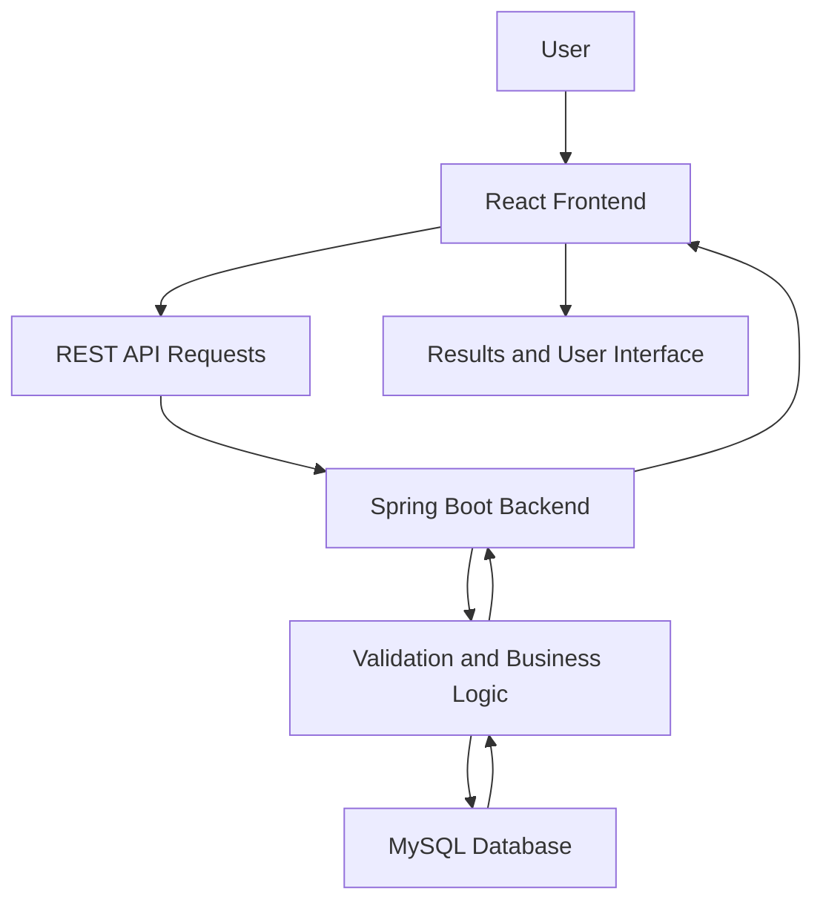
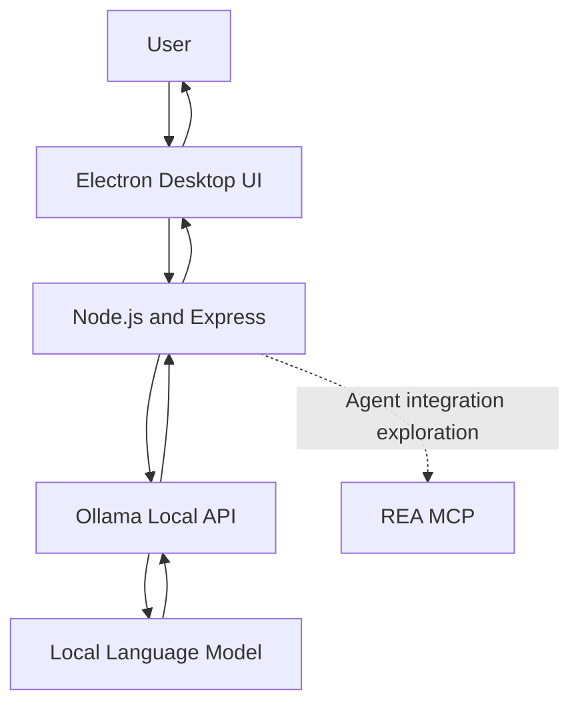

<!--
  YASHWANT KUMAAR TS — GITHUB PROFILE README

  SETUP:
  1. Save this file as README.md in your profile repository:
     https://github.com/yashwantkumaar/yashwantkumaar
  2. Add your banner image at assets/github-banner.png
  3. Replace screenshot placeholders with real project screenshots.
  4. Update repository links and certification URLs where needed.
-->

<!-- ==================== HERO SECTION ==================== -->

  

  <h1>Hi 👋, I'm Yashwant Kumaar TS</h1>

  <h3>Software Engineer | Full Stack Developer | Generative AI Enthusiast</h3>

  

    Building useful software through clean code, thoughtful engineering,
    and continuous learning.
  

  

    
    
    
  

  

   

  
  

---

<!-- ==================== ABOUT ME ==================== -->

## 👨‍💻 About Me

I'm a software developer at **Wipro**, with a B.E. in Electronics and Communication Engineering and a strong interest in building end-to-end software applications.

I enjoy working across frontend interfaces, backend services, databases, and AI-powered applications. I like turning ideas into practical projects, exploring new technologies, and improving my engineering skills through hands-on development.

- 💼 **Profession:** Software Developer at Wipro
- 🎓 **Education:** B.E. in Electronics and Communication Engineering
- 🌐 **Core Focus:** Full Stack Development
- ⚛️ **Frontend:** React.js, JavaScript, TypeScript, HTML, CSS
- ☕ **Backend:** Java, Spring Boot, Node.js, REST APIs
- 🗄️ **Databases:** MySQL, MongoDB, Firebase
- 🤖 **AI Interests:** Generative AI, LLMs, RAG, embeddings, and AI agents
- ☁️ **Cloud:** Google Cloud Associate Cloud Engineer certified
- 🤝 **Interests:** Software engineering, open source, and AI product development

> My goal is to engineer reliable, maintainable applications that solve real-world problems.

---

## 🧭 Quick Navigation

- [Technical Skills](#-technical-skills)
- [Featured Projects](#-featured-projects)
- [Project Architecture](#-project-architecture)
- [Project Screenshots](#-project-screenshots)
- [Certifications](#-certifications)
- [GitHub Statistics](#-github-statistics)
- [Currently Learning](#-currently-learning)
- [Career Goals](#-career-goals)
- [Connect With Me](#-lets-connect)

---

<!-- ==================== TECH STACK ==================== -->

## 🧰 Technical Skills

### Frontend Development

  

### Backend Development

  

### Databases and Cloud

  

### AI and Developer Tools

  

| Category | Technologies |
|---|---|
| Languages | Java, JavaScript, TypeScript, Python, C |
| Frontend | React.js, Redux, HTML5, CSS3, Bootstrap, Tailwind CSS |
| Backend | Spring Boot, Node.js, Express.js, REST APIs |
| Databases | MySQL, MongoDB, Firebase |
| AI and ML | LLMs, RAG, Hugging Face, embeddings, vector databases |
| Cloud and DevOps | Google Cloud, Docker, Git, GitHub, CI/CD fundamentals |
| Tools | VS Code, Android Studio, Postman, Vite, npm |
| Exploring | MCP, AI agents, system design, scalable architectures |

*The table includes technologies I work with and areas I am actively exploring.*

---

<!-- ==================== FEATURED PROJECTS ==================== -->

## 🚀 Featured Projects

A selection of projects showcasing my interests in full-stack development, interactive applications, and AI.

### 🎮 1. IGNITE — Multiplayer Truth or Dare

**An interactive game built for memorable game nights.**

A responsive Truth or Dare experience featuring a collection of questions, animations, sound effects, and a leaderboard.

**Key features**
- Interactive Truth or Dare gameplay
- Responsive interface for different screen sizes
- Animated user interactions and sound effects
- Leaderboard and game-focused UI

**Tech stack:** `HTML` `CSS` `JavaScript` `Netlify`

**[🎮 Play Live Demo](https://truthordarewithfrndss.netlify.app/)**

---

### 🛒 2. E-Commerce Website

**A web application for essential online shopping workflows.**

A responsive shopping application built around product browsing, authentication, cart functionality, and product management.

**Key features**
- Product browsing and shopping cart
- User authentication workflows
- Product management
- Frontend-to-backend integration

**Tech stack:** `React` `Node.js` `Express` `MongoDB`

**[🛍️ Explore Live Demo](https://dpenterprisesupdated.netlify.app/)**

---

### 🏦 3. Loan Eligibility Prediction System

**A full-stack application concept for loan eligibility evaluation.**

An application designed to collect financial inputs, evaluate eligibility, and present results through a clean interface.

**Key features**
- Structured financial input forms
- Input validation
- REST API integration
- Database-backed customer data management
- Eligibility prediction workflow

**Tech stack:** `React.js` `Spring Boot` `MySQL` `REST APIs`

**Repository:** [Add your GitHub repository URL](https://github.com/yashwantkumaar)

---

### 🤖 4. Parkeet AI — Desktop AI Assistant

**Exploring local AI models and desktop application integration.**

An experimental desktop AI assistant combining an Electron interface, a Node.js backend, Ollama, and a local language model.

**Key features**
- Desktop application using Electron
- Local LLM integration through Ollama
- Express backend and API communication
- Exploration of MCP-based agent workflows
- Local AI experimentation

**Tech stack:** `Electron` `Node.js` `Express` `Ollama` `Qwen 2.5 Coder` `REA MCP`

**Repository:** [Add your Parkeet AI repository URL](https://github.com/yashwantkumaar)

---

### 🧠 5. AI Interview Preparation Platform

**Exploring AI-assisted interview practice.**

An AI interview project combining resume analysis, mock interview workflows, language model integration, and speech recognition.

**Key features**
- Resume analysis workflow
- Mock interview experience
- Speech recognition integration
- AI-generated interview interactions

**Tech stack:** `Python` `Flask` `LLM APIs` `Vosk`

**Repository:** [Add your GitHub repository URL](https://github.com/yashwantkumaar)

---

### 🎬 6. DeepFake Video Detection

**A deep learning project exploring video authenticity classification.**

A project combining visual feature extraction and temporal modeling to investigate the classification of potentially manipulated videos.

**Key features**
- Video feature extraction
- Deep learning-based classification
- Temporal sequence modeling
- Flask-based application integration

**Tech stack:** `Python` `ResNeXt` `LSTM` `Flask`

**Repository:** [Add your GitHub repository URL](https://github.com/yashwantkumaar)

---

<!-- ==================== ARCHITECTURE ==================== -->

## 🏗️ Project Architecture

### Full Stack Application

The following diagram illustrates a typical architecture for a React and Spring Boot application.

### Local AI Assistant

Illustrative architecture for the Parkeet AI development project.

*These diagrams show the intended high-level architecture. Adapt them to match the final implementation in each repository.*

---

<!-- ==================== PROJECT SCREENSHOTS ==================== -->

## 🖼️ Project Screenshots

Add real screenshots of your projects to make your profile more visual and help recruiters understand your work quickly.

### IGNITE — Truth or Dare

<!-- Add your screenshot to assets/ignite.png -->

  

  <a href="https://truthordarewithfrndss.netlify.app/">Open Live Demo</a>

### E-Commerce Website

<!-- Add your screenshot to assets/ecommerce.png -->

  

  <a href="https://dpenterprisesupdated.netlify.app/">Open Live Demo</a>

### Parkeet AI

<!-- Add your screenshot to assets/parkeet-ai.png -->

  

*Create the `assets` directory in your profile repository and upload your actual screenshots. Until those files exist, the image placeholders will not display.*

---

<!-- ==================== PROJECT QUALITY ==================== -->

## 📈 Engineering Quality and Impact

I aim to improve not just what my applications do, but how reliably and efficiently they do it.

| Area | What to demonstrate |
|---|---|
| Code quality | Readable, maintainable components and clear project structure |
| Testing | Unit tests, integration tests, and meaningful test cases |
| API design | Validation, appropriate HTTP status codes, and error handling |
| Performance | Measured response times and optimization results |
| Reliability | Reproducible setup, clear dependencies, and error handling |
| Documentation | Setup instructions, API documentation, and architecture diagrams |
| Deployment | Working demos and documented deployment processes |

### Project Metrics

Add verified measurements when you have them.

- **Automated tests:** Add your actual test count and results.
- **API performance:** Add measured latency and test conditions.
- **Code coverage:** Add the percentage from your coverage report.
- **Performance improvements:** Document the baseline and measured result.
- **Project adoption:** Add verified usage figures, if available.

*No performance or adoption figures are claimed here because they should be supported by actual project measurements.*

---

<!-- ==================== CERTIFICATIONS ==================== -->

## 🎓 Certifications

  

- **Google Cloud Associate Cloud Engineer**
- Wipro TalentNext
- Full-Stack Development
- C and Python certifications

*Add credential verification links and issuing organizations where available.*

---

<!-- ==================== GITHUB STATS ==================== -->

## 📊 GitHub Statistics

  
  

  

  

  <i>Consistent learning, practical projects, and continuous improvement.</i>

---

<!-- ==================== LEARNING ==================== -->

## 📚 Currently Learning

  
  
  
  
  
  
  
  

- 🤖 Building applications powered by language models
- 🔎 Exploring retrieval pipelines, embeddings, and vector search
- 🔗 Learning about AI tool integration and MCP
- ☕ Improving backend development with Java and Spring Boot
- ☁️ Exploring cloud deployment and CI/CD practices
- 🧱 Strengthening software architecture and system design fundamentals

---

<!-- ==================== CAREER GOALS ==================== -->

## 🎯 Career Goals

- Build production-ready applications that solve practical problems.
- Strengthen full-stack and backend engineering skills.
- Develop AI-powered tools with meaningful user value.
- Contribute to open-source software.
- Improve problem-solving, testing, and system design.
- Grow into a software engineer capable of designing and delivering reliable systems.

---

<!-- ==================== DEVELOPER PHILOSOPHY ==================== -->

## 💡 Engineering Philosophy

- **Understand the problem** before choosing a solution.
- **Write maintainable code** that other developers can understand.
- **Test assumptions** instead of relying on guesses.
- **Document decisions** so projects are easier to run and extend.
- **Keep learning** because software engineering never stands still.

> First, solve the problem. Then, write the code.

---

<!-- ==================== CONTACT ==================== -->

## 🤝 Let's Connect

I'm interested in software engineering, full-stack development, AI applications, and opportunities to collaborate on useful projects.

  
  
  

  ### ⭐ Thanks for visiting my profile!

  **Building today. Learning every day. Engineering a better tomorrow. 🚀**

